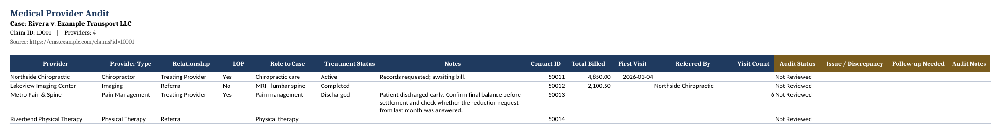
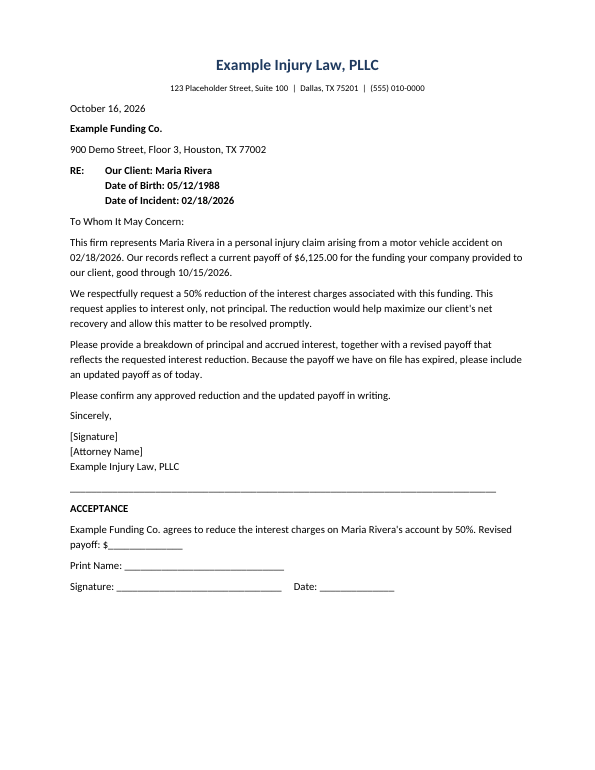

# Legal AI Workflows

Four AI agent workflows I built for a personal injury law firm, rebuilt here as a portfolio project.
Each one comes in two forms: the **agent skill** (the prompt instructions an LLM agent follows)
and a **working Python version** of the same rules that runs on synthetic case data. A small
**MCP server** and a **demo web page** let you try them live.

**Live demo:** _add your Render URL here after deploying_ ([how to deploy](#deploy-the-live-demo-on-render))

| Workflow | What it does | Output |
|---|---|---|
| [Medical Provider Audit](#1-medical-provider-audit) | Pulls a case's medical providers from the case management system into an audit spreadsheet | `.xlsx` workbook |
| [E-filing Document Renamer](#2-e-filing-document-renamer) | Turns the caption of an e-filed court document into a standard filename with a confidence rating | Review table |
| [Provider Reductions](#3-provider-reductions) | Drafts reduction request letters to medical providers and litigation-funding companies from ledger data | One-page PDF letters |
| [Case Treatment Auditor](#4-case-treatment-auditor) | Checks whether the client is still treating, reconciles the ledger against bills and records, and lists red flags | Provider table, red flags, records custodian list |

> **This is a sanitized rebuild.** It contains no firm code, templates, case data, client
> information or configuration. The firm's case management system (CMS) is replaced by a
> mock client that reads synthetic JSON, and every name, address, ID and URL is fictional.

## Why I built these

At the firm, routine case work meant copying data out of the CMS by hand: building medical
audit spreadsheets, renaming and filing court documents, checking ledgers against bills, and
writing reduction letters. I wrote these skills and plugins so a ChatGPT agent, connected to the CMS through an MCP (Model Context Protocol) server, could
do the retrieval, calculation and formatting, while the staff member still made the decisions.

### Impact at the firm

These are my own estimates from day-to-day use, not measured figures:

| Workflow | Typical volume | Estimated time saved |
|---|---|---|
| Medical and treatment audits | about 6 per week | about 1 hour on simple cases, about 2 hours on complex ones |
| Records custodian lists | 2 to 3 per week | about 1 hour each |
| Reduction letters | about 4 cases per week | from 40 to 60 minutes down to about 15 minutes per case |
| E-filing review and renaming | daily | from about 30 minutes down to 5 to 10 minutes |

Altogether, about 10 hours a week (estimated).

The same principles run through all four:

- **Read-only by default.** The agent never writes to the CMS unless asked.
- **Never guess.** An ambiguous case name, a duplicate ledger entry or an unreadable caption stops
  the workflow and asks the person, instead of picking one.
- **Never invent data.** A missing amount, date or address stays blank and gets flagged.
- **Show your confidence.** Results carry a confidence rating, a `NOT FINAL` mark or a red flag, so
  the reviewer knows where to look first.
- **Check before delivering.** Counts are reconciled, outputs are rendered and inspected, and
  filenames follow the firm's convention exactly.

## Repository layout

```
legal-ai-workflows/
├── skills/                        the four agent skills (SKILL.md + agents/openai.yaml)
│   ├── create-medical-case-audit/
│   ├── efiling-document-renamer/
│   ├── provider-reductions/
│   └── case-treatment-auditor/
├── src/legal_workflows/           Python versions of the same rules
│   ├── cms.py                     read-only CMS interface + mock implementation
│   ├── common.py                  name matching, dates, currency rounding
│   ├── medical_audit/
│   ├── efiling/
│   ├── reductions/
│   ├── treatment_audit/
│   ├── mcp_server.py              MCP server: read-only CMS tools + workflow tools
│   ├── web.py                     demo web page and API (also serves /mcp)
│   ├── static/index.html          the demo page
│   └── cli.py                     the `legal-workflows` command
├── mock_cms/claims/               synthetic cases shared by every workflow
├── sample_inputs/                 an e-filing inbox and a reduction request
├── examples/                      outputs generated from the sample data
├── Dockerfile, render.yaml        deployment for the live demo
└── tests/                         pytest suite (45 tests)
```

## Quick start

```bash
python -m venv .venv
source .venv/bin/activate          # Windows: .venv\Scripts\activate
pip install -e ".[dev]"

legal-workflows --out output audit "https://cms.example.com/claims?id=10001"
legal-workflows --out output rename
legal-workflows --out output treatment 10001 --as-of 2026-10-16
legal-workflows --out output reductions --keep-docx
pytest

uvicorn legal_workflows.web:app --reload   # demo page at http://127.0.0.1:8000, MCP at /mcp
```

In the original skill, ChatGPT converted the letters to PDF inside its own workspace. When you run
this Python version on your own computer, it needs a converter for that step, so it uses
[LibreOffice](https://www.libreoffice.org/) (free) if it finds `soffice` on your PATH. LibreOffice is
optional: without it, the reductions workflow saves the letters as `.docx` and says it skipped the
PDF step. Everything else runs without it.

## The shared mock CMS

Every workflow reads the same synthetic case, *Rivera v. Example Transport LLC* (claim `10001`),
through one small read-only interface in `cms.py`: `list_claims`, `get_claim`,
`get_claim_contacts`, `get_ledger`, `get_treatment_notes`, `get_documents` and `list_clients`.
The case was designed to contain realistic problems: a duplicated ledger entry, a provider spelled
two ways, a bill that only exists in the intake folder, an expired loan payoff, conflicting
addresses, and a client who is still treating.

At the firm, the agent reached the CMS through an MCP server that exposed its read endpoints as tools.
The skills tell the agent how to use that connection safely: load the server's own access rules first,
discover the documented read tools before calling anything, prefer the lightest endpoint, and stay
read-only. To connect a real CMS here, implement the same methods against its API or MCP server. The
workflow code would not change.

## The MCP server

At the firm I connected my agent skills to the CMS vendor's existing MCP server. For this project
I built an MCP server myself ([`mcp_server.py`](src/legal_workflows/mcp_server.py)), using the
official Python SDK, so an AI agent can work with the mock CMS the same way.

- **11 tools, all read-only** and annotated as such: `get_usage_rules`, `list_claims`, `get_claim`,
  `get_claim_contacts`, `get_ledger`, `get_treatment_notes` and `get_documents` for the CMS, plus
  `medical_provider_audit`, `treatment_audit`, `rename_efiled_documents` and `plan_reduction_letter`
  for the workflows.
- **Usage rules first.** The server's instructions and `get_usage_rules` give the rules the skills
  expect: stay read-only, never guess between matching claims, prefer the lightest tool, never invent values.
- **Safe errors.** A case name that matches two claims returns an error asking the agent to check
  with the user. A reduction with duplicate ledger entries comes back as `needs_input`.
- **Two transports.** It runs over stdio for desktop MCP clients, or streamable HTTP at `/mcp`, with
  DNS-rebinding protection limited to localhost and the deployed hostname.

```bash
python -m legal_workflows.mcp_server           # stdio, e.g. for Claude Desktop
python -m legal_workflows.mcp_server --http    # http://127.0.0.1:8000/mcp
npx @modelcontextprotocol/inspector            # optional: browse and call the tools
```

## Deploy the live demo on Render

The repo includes a `Dockerfile` (Python, the app, and LibreOffice for PDFs) and a `render.yaml`.

1. Push the repo to GitHub.
2. In Render, choose **New > Blueprint** and pick the repo. Render reads `render.yaml` and builds the Docker image.
3. When it's live, open the URL. The demo page is at `/` and the MCP server is at `/mcp`.

Render sets `RENDER_EXTERNAL_HOSTNAME` automatically, and the MCP server allows that host. On the
free plan the service sleeps when idle, so the first visit can take a minute to wake up.

---

## 1. Medical Provider Audit

**Skill:** [`skills/create-medical-case-audit`](skills/create-medical-case-audit/SKILL.md) ·
**Code:** [`src/legal_workflows/medical_audit`](src/legal_workflows/medical_audit)



1. Resolves the claim from a URL (`?id=`), a numeric ID or a case name. If a name matches more than
   one claim, it asks instead of guessing.
2. Keeps only contacts whose role is `Medical Provider` (case-insensitive) and expands their custom
   fields by label, handling text, dropdown, date, number, decimal and contact-reference values.
3. Builds the workbook with a title band, common columns, any extra custom fields, and editable audit
   columns. It has a filterable table, frozen headers and dropdowns for Audit Status and Follow-up Needed.
4. Verifies before saving: the provider count matches the source, there are no formula errors, and
   column widths are readable. A case with no providers gets a visible
   "No medical providers found" notice instead of fabricated rows.

## 2. E-filing Document Renamer

**Skill:** [`skills/efiling-document-renamer`](skills/efiling-document-renamer/SKILL.md) ·
**Code:** [`src/legal_workflows/efiling`](src/legal_workflows/efiling) ·
**Example:** [`examples/efiling`](examples/efiling/efiling_rename_table.md)

Names documents `[YYYYMMDD] [CLIENT LAST] [CLIENT FIRST] [DESCRIPTION]`. For example, a petition
received October 7, 2026 becomes `20261007 RIVERA MARIA PLAINTIFFS ORIGINAL PETITION`.

| Confidence | When |
|---|---|
| `LOW` | Multiple plaintiffs, an unreadable caption, or no plaintiff matches a firm client |
| `MEDIUM` | The client matches by last name only, or the cause number, court or description is missing |
| `HIGH` | One plaintiff who clearly matches a client, with every field present |

Rows needing review sort to the top, each with the reason. Dates keep their leading zeros
(October 8, 2026 is `20261008`), so every filename sorts in date order and no two dates can share a code.

*In the original workflow ChatGPT read the caption off each PDF. The Python version starts from
caption fields that have already been extracted, and identifies "our client" by matching plaintiffs
against the firm's client list.*

## 3. Provider Reductions

**Skill:** [`skills/provider-reductions`](skills/provider-reductions/SKILL.md) ·
**Code:** [`src/legal_workflows/reductions`](src/legal_workflows/reductions) ·
**Examples:** [`examples/reductions`](examples/reductions)



- **Medical providers:** applies the requested percentage to the pre-reduction bill (an 85%
  reduction leaves 15% due), rounded to cents. It uses a reduction already entered in the ledger
  only when the entry is marked as one; otherwise it asks for a target.
- **Litigation-funding companies:** requests a reduction of **interest only**, asks for a breakdown of
  principal and interest, and never invents that split. If the payoff letter has expired, it flags it
  and asks for an updated payoff.
- **Safeguards:** it skips providers on hold, stops if a provider has more than one ledger entry,
  and flags conflicting addresses instead of picking one.
- **Templates, not retyping:** it fills `{{PLACEHOLDERS}}` in a Word template run by run, so the
  letter's formatting is untouched, then converts it to PDF. It checks that the PDF is one page and
  contains the right payoff, client and entity.
- Files are named exactly `Reduction Request - Provider Name - Client Name.pdf`.

*The firm's letterhead, approved templates, wording and attorney signature are not included. The
templates here were written from scratch as generic stand-ins.*

## 4. Case Treatment Auditor

**Skill:** [`skills/case-treatment-auditor`](skills/case-treatment-auditor/SKILL.md) ·
**Code:** [`src/legal_workflows/treatment_audit`](src/legal_workflows/treatment_audit) ·
**Example:** [`examples/treatment_audit`](examples/treatment_audit/Rivera%20v.%20Example%20Transport%20LLC_Treatment_Audit.md)

| Provider | Treatment Period | Total Charge Amount |
|---|---|---|
| Northside Chiropractic | 03/04/2026 - 10/01/2026 | $4,850.00 NOT FINAL |
| Lakeview Imaging Center | 03/20/2026 | $2,100.50 |
| Metro Pain & Spine | 03/10/2026 - 06/30/2026 | $3,600.00 |
| Riverbend Physical Therapy | 09/12/2026 - 10/03/2026 | $1,250.00 NOT FINAL |
| **Total** | | **$11,800.50 NOT FINAL** |

- **Treatment status comes first, and doubt means "still treating."** A follow-up, a referral, a
  recent visit or an open status keeps a provider marked as treating, along with the note that
  raised the doubt.
- **Ledger reconciliation:** it finds duplicate entries, providers with bills but no ledger entry,
  ledger entries with no bill, mismatched amounts, and the same provider spelled differently.
- **Document store:** it treats `billing` and `records` as primary, `intake` as backup and `archive`
  as reference only. A copy of a file in two folders is counted once.
- **Output:** the provider table, then short red flags tied to their source, then a draft records
  custodian list that flags missing addresses instead of inventing them.

---

## How this compares to the original work

Everything here is a generalized version of the workflows I built and used at a personal injury law
firm. The steps, rules and outputs match what I used day to day; firm names, templates and case
data are replaced with fictional stand-ins. The key differences:

| | At the firm | In this repo |
|---|---|---|
| **Case management system** | The firm's real system | A mock system of fictional cases stored in JSON files |
| **MCP** | I connected my agents to the vendor's existing MCP server | To show how the agents work end to end, I built a mock MCP server with 11 read-only tools |
| **Who runs the workflow** | A ChatGPT agent following the skill instructions | The same instructions, plus Python versions of the rules that run and can be tested without ChatGPT |
| **Reading documents** | ChatGPT read the PDFs, captions and notes | The Python versions start from information already pulled out of the documents |
| **Letter templates** | The firm's approved templates | Generic templates I wrote from scratch |
| **Trying it out** | Used internally by the litigation team | A public demo page, 45 automated tests and a Render deployment |

## Tech

| Tool | What it does here |
|---|---|
| Python 3.10+ | The language everything is written in |
| openpyxl | Creates the Excel audit workbook (table, dropdowns, frozen headers) |
| python-docx | Fills in the Word letter templates for reduction requests (creates documents; nothing here reads them) |
| LibreOffice | Converts the finished Word letters to PDF (optional; see Quick start) |
| pypdf | Checks each finished PDF: one page, with the right payoff, client and provider |
| MCP Python SDK | Builds the MCP server that lets AI agents call the tools |
| FastAPI | Runs the demo web page and its API |
| Docker + Render | Packages the app and hosts the live demo |
| pytest | Runs the 45 automated tests |

**No AI model or API is called by the code.** The Python versions apply the workflow rules directly,
so they're free to run and give the same answer every time. The AI side is the skill instructions
(`SKILL.md` + `agents/openai.yaml`, the ChatGPT/Codex skill format, usable as plain instructions in
other agent tools) and the MCP server, which any AI agent such as ChatGPT or Claude can connect to.

## Improving these workflows

These are planned next steps, not features that exist yet.

### 1. Evals: measure how well the agent follows each skill

The Python tests check the rules. Evals would check the **AI agent**: give it a skill and the MCP
server, run it against a fixed set of fictional cases with known answers, and score what it does.

- **A golden test set.** Build 30 to 50 synthetic cases with planted problems (duplicate ledger
  entries, a client still treating, two plaintiffs, an expired payoff), each with the correct answer
  written down ahead of time.
- **Automatic scoring.** Compare the agent's output with the known answers, and log every MCP tool
  call to check *how* it got there.
- **Run on every change.** Re-run the evals whenever a `SKILL.md` changes, so a wording tweak that
  makes the agent worse is caught before anyone relies on it.

### 2. Metrics for each workflow

| Workflow | What to measure |
|---|---|
| Medical provider audit | Provider count matches the source; every value matches the CMS exactly; no invented rows |
| E-filing renamer | Filename exact-match rate; client identified correctly; how often LOW/MEDIUM flags catch the documents that really needed review |
| Provider reductions | Payoff math correct to the cent; right letter type (provider or funding company); held providers skipped; no invented principal/interest split |
| Case treatment auditor | Share of planted red flags found (recall); share of flags that were real (precision); how often a still-treating client is wrongly marked finished (the most costly mistake) |

**Across all of them:**
- **Hallucination rate:** any name, date or amount in the output that isn't in the source data.
- **Ask-don't-guess rate:** when a case is ambiguous, did the agent stop and ask?
- **Tool use:** did it read the usage rules first, stay read-only and avoid unnecessary calls?
- **Cost and speed:** tokens and time per run.

For letter wording and tone, which can't be checked by exact match, I'd add a scoring rubric graded
by a second model ("LLM as judge"), spot-checked by a person.

### 3. Other improvements

- **Document reading:** add the PDF and caption extraction step (OCR plus an LLM) with its own
  accuracy evals, so the repo covers the full workflow end to end.
- **Human approval for write-back:** let the agent propose CMS updates (like a corrected treatment
  status) that a person approves before anything is saved.
- **Monitoring:** log tool calls and flags over time to spot which rules people override most,
  and tune the skills from that.
- **More test cases:** add tricky cases such as misspelled names, partial records and conflicting
  dates.

## Using this in your own work

The skills are written to be adapted. Swap the CMS interface for your own system, replace the
templates with your firm's, and adjust the confidence rules or red-flag checks to match how your
team works. This project is not legal advice, and its output should always be reviewed by a
qualified person.
